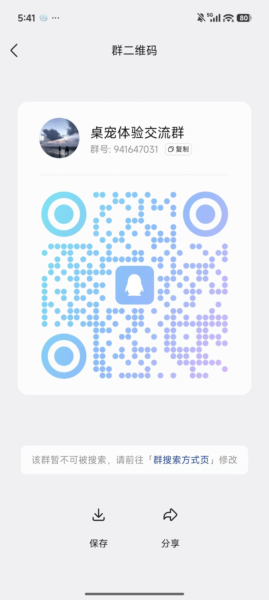

# 🐾 SoulDesktopPet

> A desktop pet that lives on your computer — combining **emotional companionship, memory keeping, and practical utility** in one.
> It looks cute while quietly remembering the people and things you would otherwise forget.

[English](README.md) | [简体中文](README.zh-CN.md)

---

## 🌟 What Is It?

**SoulDesktopPet** is a local-first desktop app that merges companionship with a personal memory keeper:

- 💝 **Emotional value** — a pet that lives on your desktop, acts cute, walks around, and comes over to be petted;
- 🧠 **Memory value** — remembers contact preferences, taboos, and gift ideas; reminds you of birthdays and festivals; keeps memory events with photo albums;
- 🛠 **Practical value** — schedules work events on a schedule, and exports memory albums to PDF / MP4 with one click.

**🔒 All data stays on your own computer (`%APPDATA%/SoulDesktopPet/`) — no cloud, no upload, no network calls.**

---

## ✨ Core Features

### 👥 Contact Management
- Create / edit / delete contacts, with custom avatars, nicknames, and relationships;
- Bind three tag categories per contact — **likes · taboos · gifts** — managed from a global tag library;
- Record important dates in the Gregorian or the **Chinese lunar calendar**, either one-off or recurring yearly.

### 📅 Recurring Reminders
- Birthdays, anniversaries, and festivals trigger on a cycle;
- **Lunar (traditional Chinese) calendar dates are supported**, with a built-in festival library: Valentine's Day, Teacher's Day, Qixi, Christmas, Father's Day… including floating festivals that are computed automatically;
- The pet shows an unread reminder badge in the corner and wakes you up when the time comes.

### 📷 Memory Events & Album Export
- "Memory events" record moments on a timeline, keeping every important highlight;
- One event can hold multiple photos — perfect for ritual moments like *"our first trip together"*;
- One-click export to a **PDF album** or an **MP4 video album**, with multiple templates and a live WYSIWYG preview;
- **Annual album**: automatically gathers all memories from a given year for a year-in-review.

### 💼 Work Event Reminders
- One-off or **cron-scheduled recurring** work reminders;
- Shown on a separate channel from personal events — never in the way, never missed.

### 🐾 The Pet Itself
- Translucent, borderless, always-on-top window that walks, idles, and falls asleep on its own;
- **Single click / double click / right click** interactions: pet the head, pat the head, feed, play, sleep, hug;
- Right click opens the **Cozy interaction menu** — all 6 actions are customizable per character animation.

### 💞 Intimacy System (three-layer architecture)
- **Bond (permanent bond)**: settled weekly across 10 dimensions, upgrading quarterly — your long-term relationship with the pet;
- **Cozy (short-term warmth)**: decays over time, a little more with each play session, and drives the pet's current mood;
- **Mood (emotion)**: derived from Cozy plus the day's activity, and drives the pet's expression filters.

> Advanced interactions such as double-click head patting unlock at intimacy tier ≥ 5.

### 🎨 Customization & Pluggable Characters
- Every pet can be configured independently: click action / idle loop action / 6 cozy actions in the right-click menu;
- Upload a frame-animation PNG package and **a new pet is generated automatically and ready to use**;
- **Only imported pets get a delete button** in the pet list; built-in pets (the ones under `resources/pets/`) offer no delete action. Whether a pet is deletable is decided by **where it actually lives on disk**, not by the shape of its id — so promoting an imported pet to a built-in no longer leaves behind a delete button that does nothing.
- **Deleting a pet takes its data with it**: the bond score, the cozy meter, the weekly tallies, the interaction history, and the pet's own action bindings and bubble texts are all removed too — no orphaned rows are left behind in the database pointing at a pet that no longer exists. The app also sweeps up any such leftovers from earlier versions on every startup.
- Built-in frame splitter: cut a video into a PNG sequence and zip it — DIY your own desktop pet;
- **Background removal** ("Tools → Image Background Removal") turns a picture's backdrop transparent. It decides what counts as background by *connectivity* plus *edge strength*, not by colour alone: every pixel is priced by how far its colour is from the backdrop **and** how strong an edge it sits on, and the background is whatever can be walked to from the image border without crossing a pixel that is too expensive. The anti-aliased fringe around the character sits on a strong edge, so the flood stops there instead of chewing into the character — which is why the black hair, clothing and outlines survive even when the backdrop is black. The same cutout runs automatically on every frame of an imported pet package, and produces byte-identical output to the tool's default setting.
- **Two kinds of imported frames are accepted**: *opaque* PNGs (the default — flat backdrop, cut out automatically on upload) and *transparent* PNGs (already cut out — the cutout is **skipped**, so the edges are left exactly as you exported them). The type is detected per frame, so a single package may mix both.
- **Live import progress**: uploading a package shows a progress bar with a "processed N / total images" counter and a percentage, ticking up after every finished frame — no blind waiting while the frames are cut out one by one.
- **Batch image resize** ("Tools → Batch Image Resize") shrinks every image in a folder by a chosen factor and writes the results into a folder you pick — **your originals are never modified**. The factor can be 1/2, 1/3, 1/4, 1/8 or a custom value (decimals allowed). The source folder's **sub-directory structure is mirrored** into the output, so frame sets organised per action stay organised after shrinking. Scaling uses the lanczos algorithm, which keeps quality high; **the alpha channel survives intact**, so cut-out character art shrinks without gaining white fringes or jagged edges. Images with transparency are always written as PNG; plain JPEGs and the like keep their own format. The output folder may not be the source folder, nor live inside it — so a mis-click can never destroy the originals.
- **Outline stripping & hole repair**: many Live2D-style sprites are exported with a bright "sticker" stroke around the character. The cut removes that stroke too — and it locates it by *geometry*, not by brightness alone: the stroke is the narrow bright band hugging the cut edge, while the character's own white hair, shirt and skin are enclosed hundreds of pixels deep. So the black hat, cape, vest and boots survive, the enclosed white areas survive, and the halo is gone. A character that is simply *bright* at its edge is left alone — the bright band has to peak and fall again to count as a stroke. Any hole the cut opens inside the character is then closed again, so an imported package can never come out with a black hole in it.
- **Black-edge removal**: artwork that draws the character with its own black contour comes out of the cut wearing that contour — a dark rim following the silhouette, over a desktop it reads as a black halo. The cut therefore grows the transparent region **5 pixels outward** past the boundary it found, so the rim is swallowed with the backdrop. The growth is gated on the backdrop *colour* and on *connectivity* — it re-runs the same flood with the edge-strength term switched off, so it can only reach pixels that still look like backdrop — and it is bounded by the 5-pixel radius, so it can never eat more than a hairline of the character. Measured on the shipped pet frames, **0%** of the character's interior is touched, while roughly 7,000 outline pixels per frame are cleaned away.
- **Small black dot removal**: a handful of leftover background specks can survive the cut — a few pixels of backdrop trapped behind a thin strand of the character's line art. Those are found by looking for kept pixels that are still **backdrop-coloured** and grouping them into blobs; any blob small enough to be noise (and flat enough to be leftover material rather than drawn detail) is made transparent. Larger detached fragments — a sword, a stray hair — are left alone.

### 🔄 Software Auto-Update
- Updates come from **GitHub Releases** and can be checked manually under "Settings → Software Update";
- Checks run **automatically once a day**, silently, without interrupting your pet;
- Downloaded installers are verified with **SHA-256** before execution — a file that fails verification is never installed;
- User data (contacts / reminders / memories / photos) lives in `%APPDATA%\SoulDesktopPet\`, separate from the install directory, so **upgrading never deletes it**.

### 🔐 Privacy & Security
- The main window requires a 4-digit PIN to unlock (default `1234`), changeable under "Settings → Access Password";
- **Fully local database**: uses sql.js (pure-JS SQLite), zero native dependencies, and never calls any cloud API;
- One-click export / import of zip backups for painless whole-machine migration.

> Auto-update is only available in the **packaged Windows build**; in development mode the app points you to GitHub Releases to download manually. The repository address is the `REPO` constant at the top of `main/app_update.js`.

---

## 🚀 Installation & Running

### Prerequisites
- Node.js 18+
- Windows 10 / 11 (macOS works too, but the default packaging target is Windows)

### Install dependencies
```bash
npm install
```
A `postinstall` hook automatically pulls in the helper modules needed at runtime.

### Development mode
```bash
npm run dev
```
> Launches Electron; the main window opens automatically with DevTools attached, and the pet window stays on top.

### Production run
```bash
npm start
```

### Build the installer (Windows)
```bash
npm run build
```
> Output lands in `dist/` as an NSIS installer, which automatically creates desktop and Start menu shortcuts (named: SoulDesktopPet).

---

## 📂 Where Data Lives

All data is stored in the OS user directory:

```
%APPDATA%\SoulDesktopPet\
  ├─ soul-desktop-pet.db       ← SQLite database (sql.js)
  ├─ avatars\<contact_id>      ← custom avatars for contacts
  ├─ photos\<event_id>\        ← memory event photos
  └─ pets\                     ← built-in + user-imported pet packages
```

Backup zips are rooted at `soul-desktop-pet.db` and are restored atomically on import.

---

## 🗂 Project Structure

```
.
├─ main/                ← Electron main process (database, scheduling, IPC, pet engine)
│  ├─ main.js             entry point
│  ├─ db.js               sql.js wrapper + SQLite schema
│  ├─ scheduler.js        reminder queue + 1Hz intimacy pipeline
│  ├─ ipc.js              all IPC handlers
│  ├─ bond_engine.js      intimacy (tier 1+2) algorithm
│  ├─ cozy_engine.js      cozy (tier 3) algorithm
│  ├─ pet_controller.js   pet auto-behavior state machine
│  ├─ pet_registry.js     pet asset registry
│  ├─ pet_zip_import.js   user zip pet import
│  ├─ png_border_cutout.js  the shared cutout pipeline (mask, defringe, boundary expansion, hole repair, speck removal)
│  ├─ png_bottleneck_flood.js  cost field + edge-aware background flood
│  ├─ png_colorkey.js     PNG transparency wrapper (uses the cutout above)
│  ├─ png_alpha.js        detects frames that are already transparent
│  ├─ image_bg_remove.js  background-removal tool pipeline
│  ├─ image_batch_resize.js  batch image-resize tool pipeline (ffmpeg scale, alpha-preserving)
│  ├─ album_pdf.js        PDF album export
│  ├─ album_video.js      MP4 video album export
│  ├─ app_update.js       auto-update (GitHub Releases + SHA-256 verification)
│  └─ festivals.js        festival library
├─ pet/                 ← pet window preload
├─ src/                 ← renderer process (main window)
│  ├─ index.html
│  ├─ pet.html           ← pet window HTML
│  └─ js/
│     ├─ main.js, api.js, router.js, auth.js, pet.js
│     └─ pages/            router pages (today / contacts / events / export …)
├─ scripts/             ← utility scripts (incl. `verify-cutout.js`, the cutout regression check)
├─ docs/                ← documentation
│  └─ 角色制作与更换指南.md   ← character creation / replacement tutorial (Chinese)
├─ icons/               ← application icons (icon.ico + per-size PNGs)
├─ resources/           ← pet frame assets (several built-in pets included)
└─ package.json
```

### Module highlights

- **Main process** (`main/`): all database / filesystem / scheduling logic lives here; the renderer can only reach it through the whitelisted IPC exposed by `preload.js`;
- The **pet window** runs in its own process with a transparent, borderless, always-on-top window that never steals focus;
- The **three-layer intimacy model** is described under [Core Features](#-core-features) above.

---

## 📖 Getting Started

### 1. Unlock the main window
- On launch you get the desktop pet plus a PIN unlock screen (default PIN `8888`);
- Change the 4-digit PIN under **Settings → Access Password**.

### 2. Add a contact
- Go to **Contacts → New Contact**, fill in a name and relationship, pick or upload an avatar;
- In the contact detail page you can keep adding likes, taboos, gifts, and important dates.

### 3. Create a memory event and upload photos
- **Memory Events → New** → fill in a title, date, and linked contacts;
- In the detail page, upload photos in bulk, then export a PDF / MP4 album with one click.

### 4. Wait for pet reminders
- The pet shows an unread reminder count in the corner and pops up automatically when the time comes;
- Click the pet to bring up the main window / reminder dialog, or check everything for the day under **Today**.

### 5. Interact with the pet
- **Single click**: triggers the "single-click action" configured for that pet (default: a gentle pet);
- **Double click**: triggers the "double-click action" (default: head pat, unlocked at intimacy tier ≥ 5);
- **Right click**: opens the cozy interaction menu — pet / pat head / feed / play / sleep / hug;
- Under **Settings → Character Actions** you can freely switch the character animation bound to each trigger.

### 6. Switch pets / import a new pet
- **Settings → Desktop Pet Appearance** → pick one from the dropdown, or upload a frame-animation archive;
- 📘 Want to build your own? 👉 See the **[Character Creation & Replacement Guide](docs/角色制作与更换指南.md)**.

### 7. Back up and migrate
- **Settings → Data Migration → Export Backup** produces a zip with the database, all photos, and settings;
- **Import Backup** on another machine restores everything.

---

## 📚 Documentation

- 📘 **[Character Creation & Replacement Guide](docs/角色制作与更换指南.md)** (Chinese) — build a brand-new pet from scratch: split frames → sort PNGs → pack into a zip → import in one click.

> More documentation is on its way……

---


## 🧰 Tech Stack

| Layer | Choice |
|---|---|
| Desktop shell | Electron 32 |
| Database | sql.js (pure-JS SQLite, zero native dependencies) |
| Rendering | Vanilla HTML + ES Modules + hash router (no framework) |
| Packaging | electron-builder + NSIS |
| Video frame splitting | ffmpeg-static + fluent-ffmpeg |
| PDF generation | pdfkit |
| Lunar calendar | lunar-javascript |

> No cloud dependencies; no tracking; the network is used only when the OS updates Electron itself.

## 📸 Community Chat

Want to chat with the author and other users about pet tricks, report bugs, and share your own characters?

👉 Join the QQ group (scan the QR code below):



---

## 🙏 Acknowledgements

This project was designed and implemented with inspiration from several excellent open-source projects:

- [desktop-pet](https://github.com/TonyNa-code/desktop-pet)
- [Monica](https://github.com/monicahq/monica)
- [Immich Memories](https://github.com/sam-dumont/immich-memories)
- [PhotoBook Studio](https://github.com/romaruss/ImmichPhotoBook)
- and other open-source works that provided inspiration……

---

## 📄 License

Apache License 2.0 — see [LICENSE](LICENSE) / [NOTICE](NOTICE).
