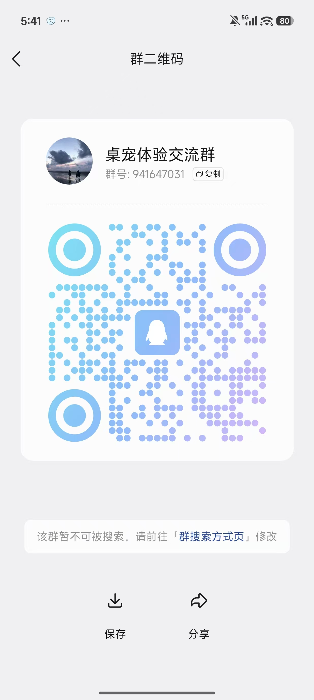

# 🐾 SoulDesktopPet

> A desktop pet that lives on your computer — combining **emotional companionship, memory keeping, and practical utility** in one.
> It looks cute while quietly remembering the people and things you would otherwise forget.

[English](README.md) | [简体中文](README.zh-CN.md)

---

## 🌟 What Is It?

**SoulDesktopPet** is a local-first desktop app that merges companionship with a personal memory keeper:

- 💝 **Emotional value** — a pet that lives on your desktop, acts cute, walks around, and comes over to be petted;
- 🧠 **Memory value** — remembers contact preferences, taboos, and gift ideas; reminds you of birthdays and festivals; keeps memory events with photo albums;
- 🛠 **Practical value** — schedules work events on a schedule, and exports memory albums to PDF / MP4 with one click.

**🔒 All data stays on your own computer (`%APPDATA%/SoulDesktopPet/`) — no cloud, no upload, no network calls.**

---

## ✨ Core Features

### 👥 Contact Management
- Create / edit / delete contacts, with custom avatars, nicknames, and relationships;
- Bind three tag categories per contact — **likes · taboos · gifts** — each managed on that contact's own detail page, behind a tab of the same name;
- Record important dates in the Gregorian or the **Chinese lunar calendar**, either one-off or recurring yearly, with a configurable **how many days ahead to start reminding**;

### 📅 Reminders
- **Recurring reminders**: birthdays, anniversaries and festivals trigger on a cycle — **one-off / daily / weekly / every N days / monthly / yearly**;
- **Work event reminders**: one-off or cron-scheduled, shown on a separate channel from personal events;
- A built-in festival library, **lunar calendar** dates and floating festivals are all computed automatically;
- The **new / edit reminder page** wears the **same background artwork** as the Reminders page, with its content laid over it as translucent sheets of paper;
- The **类型 (type) dropdown** offers **(none) / 生日 / 纪念日 / 节日**. Picking **节日** reveals a **festival picker** listing the built-in library; the reminder then fires on that festival's own day, **repeating every year**, and the repeat / date inputs hide themselves because they would have no effect.
- The pet shows an unread reminder badge in the corner and wakes you up when the time comes.
- **Automatic cleanup**: a one-off reminder is **deleted from the database** once it has been done for a full day — it can never fire again, so there is no reason to keep it. The **Reminders** page therefore does not pile up over time. **Recurring** reminders (daily / weekly / monthly / yearly, and so on) and entries whose reminder is switched off are never deleted.

### 📷 Memory Events & Album Export
- "Memory events" record moments on a timeline — in a **diary-style editor**, where the title, the body and the photos all live on one sheet of paper. Write first, save second;
- **Text and images interleave**: right-click a text block to insert a picture and it lands *after* that block. Several pictures can form a **gallery**, whose layout switches in one click between **one / two / three / grid**. Drag a picture to reorder it, drag its bottom-right handle to resize it;
- **The blocks can be swapped**: the words, the pictures, the movies and the sounds stack up in one column, and that order can be changed — **press anywhere on a block and drag it** onto another one, and the two **trade places**. The ⋮⋮ grip at the top-left just marks the handle; dragging a picture *within* its gallery still reorders the pictures, and selecting text still selects text;
- **Video and audio too**: right-click a text block to insert a movie or a sound, and it lands *after* that block as well. The movie plays on the page, the sound is a bar with a play button — and both play **as soon as they are picked**, before you save;
- **Right-clicking the media** is as handy as right-clicking a picture: insert a picture / movie / sound, insert a text block above or below, play / pause, copy the link, remove it;
- The metadata — the time, the linked contacts and the "was this the first time?" flag — is asked for when you save;
- **The list is a wall of cards**: every memory shrinks to one card, which *is* that diary page in miniature, with search and **time / contact / kind** filters;
- One-click export to a **PDF album** or an **MP4 video album**, with multiple templates and a live WYSIWYG preview. An **annual album** gathers all the memories of a given year. The album is a book of **pictures** — the movies and sounds stay in the entry.

### 🃏 Card Draw Life & Streak Wall
- **Draw one card a week** from the built-in card library — and you can add your own cards too; both live in the same pool;
- The card you drew becomes a paper card (number, title, requirement), and **记录这一张** opens the diary editor with the title and requirement already filled in;
- The **streak wall** answers "out of the five weeks I drew, how many did I actually write up?" A week counts as done only if that week's card really became a memory entry — **with a photo**, or **with more than 30 characters of text**;
- Four stats (weeks drawn / completed / completion rate / streak) sit above a wall of one square per week. A completed week is a filled orange square, so **you can see the streak at a glance**.

### 📝 Quick Record (right-click → 记录)
- **Right-click the pet → 📝 记录** opens a small dedicated window listing the six record kinds: **likes · taboos · gifts · reminder dates · memory events · work events**;
- Pick a kind and the matching form appears right there — fill it in and **保存** writes the record immediately;
- The forms are **field-for-field the same as the main window's** — the same labels, options, defaults and validation rules;
- **No main window, no PIN.** The whole point is to capture something in a few seconds without unlocking anything. The window is write-only, so it can't be used to peek at the data the PIN protects.

### 🐾 The Pet Itself
- Translucent, borderless, always-on-top window that walks, idles, and falls asleep on its own;
- **Single click / double click / right click** interactions: pet the head, pat the head, feed, play, sleep, hug;
- Right click opens the **Cozy interaction menu** — all 6 actions are customizable per character animation;
- **The whole window is the drag handle**: a press anywhere in the window starts a drag — you never have to hit the artwork itself.

### 💬 Pet Bubble Reminders
- The pet floats a **text bubble** above its head to remind you. Three kinds, each toggled separately under **Settings → Text Bubbles**:
  - **Meal reminder** — fires in the breakfast / lunch / dinner windows and ends as soon as you feed the pet;
  - **Break reminder** — fires after an hour of continuous computer use, then once every 3 hours;
  - **New version** — when an update is found, the pet **says 「有新版本」 like one of its own lines** (a blue action bubble; it does not take over the reminder bubble slot). A check that finds a new version opens a **10-minute window**; for that window the line stays plugged into the pet's speech, and it is withdrawn when the window closes — the same time-based cancellation the meal reminder uses. It comes back only on the next check. To download, use the update card in Settings.
- Every bubble kind can wear a user-picked "text box" artwork. The box **sizes itself to the text**: a short line gets a small box, a longer one widens the box (or scales the whole box up proportionally when it no longer fits), and the text stays centred inside it.

### 💞 Intimacy System
- **Bond (permanent bond)**: settled daily across 10 dimensions, upgrading quarterly;
- **Cozy (short-term warmth)**: decays over time, a little more with each play session;
- **Mood (emotion)**: driven by Cozy alone — five moods map to the five bands of the cozy score, each with its own word colour.

> Advanced interactions such as double-click head patting unlock at intimacy tier ≥ 5.

### 🎨 Customization & Pluggable Characters
- Every pet can be configured independently: click action / idle loop action / 6 cozy actions in the right-click menu;
- Upload a frame-animation PNG package and **a new pet is generated automatically and ready to use**;
- A built-in frame splitter cuts a video into a PNG sequence you can zip up yourself;
- Built-in **background removal**, **outline stripping** and **batch image resize** tools. Imported frames come in two kinds: *opaque* PNGs (cut out automatically) and *transparent* PNGs (the cutout is skipped).

### 🔄 Auto-Update · 🔐 Privacy
- Updates come from **GitHub Releases** — check manually, or let the app check silently once a day. When a new version is found, the pet says so (「有新版本」, for 10 minutes per check). Installers are verified with **SHA-256** before execution;
- The main window requires a 4-digit PIN to unlock (default `8888`), changeable under "Settings → Access Password";
- **Fully local database** (sql.js, zero native dependencies), with one-click export / import of zip backups for painless whole-machine migration.

---

## 🚀 Installation & Running

### Prerequisites
- Node.js 18+
- Windows 10 / 11 (macOS works too, but the default packaging target is Windows)

### Install dependencies
```bash
npm install
```

### Development mode
```bash
npm run dev
```
> Starts Electron with the main window and its DevTools; the pet window appears on top.

#### Debugging the "new version" pet bubble

The new-version line is event-driven — it only appears after the app actually finds a newer release, so in dev mode (where there is no installable artifact) it would normally never appear. The update card in **Settings** therefore grows a **开发模式调试** panel in dev builds only, with three buttons:

- **真的查一次 GitHub** — a real query against the latest release. If it is newer than the running version, the pet really does say the line.
- **模拟「有新版本」** — fabricates a `0.0.0-dev` notice without touching the network, so the line can be inspected on demand. Can be repeated as often as you like.
- **清除模拟提醒** — clears the simulated notice again.

Every check that finds a new version raises the line — including when it is the same version as last time (that is a new detection too). Each detection opens a 10-minute window; the line is withdrawn from the pet's speech when that window closes, and comes back only on the next check.

In dev builds the app may also query GitHub once ~60 seconds after startup (the same daily check as a packaged build) — that is why the line can appear on its own during development.

> These entries exist only in unpackaged builds. A packaged build rejects them at the main-process level, so they are unreachable from the renderer.

### Production run
```bash
npm start
```

### Build the installer (Windows)
```bash
npm run build
```
> The artifact lands in `dist/` as an NSIS installer, with desktop and Start-menu shortcuts (named SoulDesktopPet).

---

## 📖 Getting Started

### 0. How the settings page works
The settings page carries a column of section links on the left (桌宠 / 角色动作 / 动作文本 / 文本气泡 / 开机启动 / 页面背景 / 软件更新 / 数据迁移 / 访问密码 / 应用) and shows only the selected section on the right — no more scrolling through one long page. Every section has its own address (`#/settings/pet` and friends), so you can bookmark one directly.

### 1. Unlock the main window
On startup you get the pet and a PIN prompt (default `8888`). Change it under **Settings → Access Password**.

### 2. Add a contact
Go to **Contacts → New contact**, fill in a name and a relationship, pick or upload an avatar. The contact's detail page carries a row of tabs: **概览 / 喜好 / 忌讳 / 礼物**, and the overview holds that person's important dates and memory events.

### 3. Write a diary entry
**Memory Events → New** opens the diary page — write a title, pick a paper style, then write. To insert a picture, a video or an audio, **right-click** that paragraph and choose "插入图片" / "插入视频" / "插入音频". An audio can also be **recorded** instead of picked: choose **「录音」** next to it and speak into the microphone — the dialog shows a timer and a level meter. Several pictures can form a gallery: **right-click** the gallery to switch its layout, drag a picture to reorder it, and drag the bottom-right handle to resize it. A video plays on the page itself; an audio is a bar with a play button — and both play as soon as they are picked, no need to save first. **Right-click** the media itself to insert a picture / movie / sound, insert a text block above or below, play / pause, copy its link, or remove it. The order of the blocks is the order they are read in, and it can be changed: **press anywhere on a block and drag it** onto another one, and the two **swap places** — a paragraph and a picture, a movie and a sound, any two kinds. The ⋮⋮ grip at the top-left of a block is the visible sign of the handle. The content that has a gesture of its own keeps it: dragging across the words selects text, dragging a picture inside its gallery reorders the pictures, and the photo's resize handle still resizes it. Press **保存** → a dialog asks for the **time**, the **linked contacts** and whether it was **the first time**; confirm and the entry is stored, ready to export as a PDF / MP4 album.

### 4. Wait for pet reminders
The pet shows an unread reminder badge and pops up when the time comes. **Reminders can be dismissed at any time** — click the pet or the bubble above its head, **right-click the pet → 🔕 关闭提醒**, or click the **桌宠提醒** badge in the top bar. Dismissing only stops the nagging for today; the entry stays on the **Today** page, marked as done.

### 5. Interact with the pet
- **Single click**: triggers the pet's configured click action (default: a little pat);
- **Double click**: triggers the double-click action (default: head pat, unlocks at intimacy tier ≥ 5);
- **Right click**: opens the Cozy interaction menu — pat / head-pat / feed / play / sleep / dance, plus **📝 记录** for quick capture;
- Switch any of these animations under **Settings → Character Actions**.

### 6. Record something without unlocking anything
**Right-click the pet → 📝 记录** → pick a kind → fill the form → **保存**. This window asks for no password and shows no existing records — it only writes. Add your contacts first, since likes / taboos / gifts must hang off somebody.

### 7. Switch pets / import a new pet
**Settings → Desktop Pet** → pick one from the dropdown, or upload a frame-animation package.
📘 Want to make your own? 👉 **See the [Character Authoring Guide](docs/角色制作与更换指南.md)**.

### 8. Back up and migrate
**Settings → Data Migration → Export backup** produces a zip containing the database, all photos and the settings; **import** it on another machine to restore everything.

---

## 📂 Where Data Lives

All data is stored in your operating system's user directory:

```
%APPDATA%\SoulDesktopPet\
  ├─ soul-desktop-pet.db       ← SQLite database (sql.js)
  ├─ avatars\<contact_id>      ← custom contact avatars
  ├─ photos\<event_id>\        ← memory event photos
  └─ pets\                     ← built-in + imported pet packages
```

The backup zip is rooted at `soul-desktop-pet.db` too, and is replaced atomically on import.

---

## 📚 Documentation

- 📘 **[Character Authoring Guide](docs/角色制作与更换指南.md)** — how to build a pet from scratch: split frames → sort the PNGs → zip it → import it in one click.

> More documents are on the way…

---

## 🧰 Tech Stack

| Layer | Choice |
|---|---|
| Desktop shell | Electron 32 |
| Database | sql.js (pure-JS SQLite, zero native dependencies) |
| Rendering | Plain HTML + ES Modules + hash routing (no framework) |
| Packaging | electron-builder + NSIS |
| Video frame splitting | ffmpeg-static + fluent-ffmpeg |
| PDF generation | pdfkit |
| Lunar calendar | lunar-javascript |

> No cloud dependencies; no tracking; the network is used only when Electron updates itself via the OS.

## 📸 Community Chat

Want to trade pet tricks, report bugs, or share the characters you make?

👉 Join the QQ group (scan the QR code below):



---

## 🙏 Acknowledgements

This project was inspired by several fine open-source works, and we gratefully acknowledge them:

- [desktop-pet](https://github.com/TonyNa-code/desktop-pet)
- [Monica](https://github.com/monicahq/monica)
- [Immich Memories](https://github.com/sam-dumont/immich-memories)
- [PhotoBook Studio](https://github.com/romaruss/ImmichPhotoBook)
- and other open-source works that sparked ideas…

---

## 📄 License

Apache License 2.0 — see [LICENSE](LICENSE) / [NOTICE](NOTICE).
