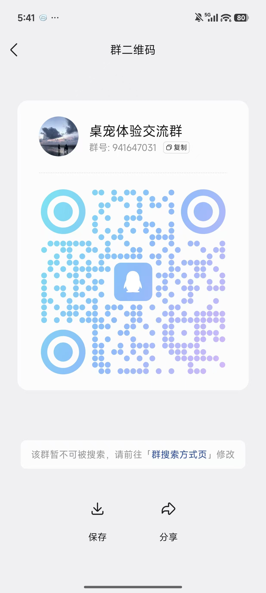

# 🐾 SoulDesktopPet · 灵魂桌宠

> 一只住进你电脑里的桌宠，把**情绪价值、记忆价值、实用价值**三合一。
> 卖萌的同时，替你记住那些最容易忽略的人和事。

[English](README.md) | [简体中文](README.zh-CN.md)

---

## 🌟 这是什么

**SoulDesktopPet（灵魂桌宠）** 是一款本地优先的桌面应用，把陪伴与记事合二为一：

- 💝 **情绪价值**——一只常驻桌面的萌宠，会撒娇、走动、主动凑上来求摸摸；
- 🧠 **记忆价值**——帮你记住联系人喜好、忌讳、礼物，节日生日自动提醒，回忆事件带相册；
- 🛠 **实用价值**——工作事件按计划闹铃，回忆一键导出 PDF / MP4 相册。

**🔒 一切数据只保存在你自己电脑里（`%APPDATA%/SoulDesktopPet/`），不上云、不上传、不联网。**

---

## ✨ 核心功能

### 👥 联系人管理
- 新建 / 编辑 / 删除联系人，自定义头像，记录昵称与关系；
- 每个联系人可绑定「喜好 · 忌讳 · 礼物」三类标签，在联系人详情页的同名页签下逐条管理；
- 重要日期按公历 / **农历**记录，支持一次性或按年循环，并可设「提前提醒天数」。

### 📅 提醒
- **周期提醒**：生日、纪念日、节日按周期触发，重复粒度支持「只一次 / 每天 / 每周 / 每 N 天 / 每月 / 每年」；
- **工作事件提醒**：一次性或按 cron 周期循环，与私人事件分通道呈现；
- 内置节日库，支持**农历**日期与浮动节日自动计算；
- 桌宠右上角实时显示未读提醒数，到点主动叫醒你。

### 📷 回忆事件 & 相册导出
- 「回忆事件」按时间线记录，**日记式编辑器**——标题、正文、照片摊在同一页上，写完再保存；
- **图文混排**：右键文字段可插入图片，图片落在该段之后；多张图片可作为「图组」，一键切换 **单图 / 双图 / 三图 / 网格** 排版；拖动图片可换顺序，拖右下角手柄可单独调整大小；
- 保存时再询问发生时间、关联联系人与「是不是第一次」；
- **列表页是卡片墙**：每篇回忆缩成一张卡片，即那一页日记的微缩版，支持搜索与**时间 / 联系人 / 类型**筛选；
- 一键导出为 **PDF 相册** 或 **MP4 视频相册**，多套模板，所见即所得；另有**年度相册**自动汇聚某一年的所有回忆。

### 🃏 抽卡人生 & 打卡墙
- **每周可以抽一张卡**，卡面来自内置卡库，你也可以自己添加卡片，两者放在同一个池子里抽；
- 抽到的卡是一张纸卡（编号、标题、要求），点「记录这一张」直接跳到日记编辑器，标题和要求已填好；
- **打卡墙**回答「抽了五周，其中几周真的写下来了？」：一周算完成，当且仅当这一周的卡真的被写成了一篇回忆记录（**有照片**，或**正文超过 30 个字**）；
- 页面上四块统计（已抽周数 / 完成 / 完成率 / 连续完成）加一张每周一格的墙，写完的那一周是填满的橙色方块——连着写了几周一眼就看得出来。

### 📝 快速记录（右键 → 记录）
- **右键桌宠 → 📝 记录**，弹出独立小窗口，列出六种记录类型：**喜好 · 忌讳 · 礼物 · 提醒日期 · 回忆事件 · 工作事件**；
- 点中类型直接弹出对应表单，填完点 **保存** 即刻入库；
- 表单与主窗口逐字段一致（同样的标签、选项、默认值和校验规则）；
- **不需要进主窗口，也不需要密码**。这个窗口只写不读，几秒钟记完一件事。

### 🐾 桌宠本体
- 半透明无边框窗体，置顶显示，自动行走 / 待机 / 入睡；
- **单击 / 双击 / 右击**多种交互：摸头、拍头、喂食、玩耍、睡觉、抱抱；
- 右击弹出 **Cozy 互动菜单**，6 种动作全部可自定义角色动画；
- 整个窗体都是拖动把手，按在任意位置都能开始拖动。

### 💞 亲密度系统
- **Bond（永久羁绊）**：按 10 个维度按日结算，季度升级；
- **Cozy（短时温馨值）**：随时间衰减，玩一次加一点；
- **Mood（情绪）**：由 Cozy 决定，五种心情对应 Cozy 的五档区间，各有自己的字体颜色。

> 双击拍头等高级互动需要亲密度 tier ≥ 5 解锁。

### 🎨 个性化 & 插拔更换
- 每个桌宠可独立配置：单击动作 / 待机循环动作 / 右击菜单 6 个 cozy 动作；
- 上传帧动画 PNG 压缩包，**自动生成新桌宠，立刻可用**；
- 内置拆帧工具，把视频按帧拆分为 PNG 序列再打包 zip；
- 内置**图片去背景**、**去除描边**、**图片批量缩小**等工具，导入的帧支持「非透明 PNG」（自动抠图）与「透明 PNG」（跳过抠图）两种类型。

### 🔄 自动更新 · 🔐 隐私
- 更新来源为 **GitHub Releases**，可手动检查，也默认每天静默检查一次；安装包先校验 **SHA-256** 再执行；
- 主窗口需 4 位 PIN 码解锁（默认 `8888`），可在「设置 → 访问密码」中修改；
- **数据库纯本地**（sql.js，零原生依赖），一键导出 / 导入 zip 备份，整机迁移无忧。

---

## 🚀 安装与运行

### 准备环境
- Node.js 18+
- Windows 10 / 11（macOS 也能跑，但默认打包目标是 Windows）

### 安装依赖
```bash
npm install
```

### 开发模式
```bash
npm run dev
```
> 启动 Electron，主窗口自动打开并附带 DevTools；桌宠窗体置顶显示。

### 正式启动
```bash
npm start
```

### 打包安装程序（Windows）
```bash
npm run build
```
> 产物在 `dist/` 下，NSIS 安装器，自动生成桌面 + 开始菜单快捷方式（名称：SoulDesktopPet）。

---

## 📖 使用入门

### 1. 解锁主窗口
启动后默认显示桌宠 + PIN 解锁界面（默认密码 `8888`），可在 **设置 → 访问密码** 中修改。

### 2. 添加联系人
进入 **联系人 → 新建联系人**，填名称、关系、选头像 / 上传自定义头像。联系人详情页带一排页签：**概览 / 喜好 / 忌讳 / 礼物**，概览里是这个人的重要日期与回忆事件。

### 3. 写一篇日记
**回忆事件 → 新建** 进入日记页面，写标题、选背景纸样，然后直接写正文。想插图就**右键**这一段，点「插入图片」；多张图可以组成一组，**右键**图组切换排版，拖动图片换顺序、拖右下角手柄改大小。点 **保存** → 弹出对话框填**发生时间**、勾**关联联系人**、选**是不是第一次**，确认后入库，之后可一键导出 PDF / MP4 相册。

### 4. 等待桌宠提醒
桌宠右上角显示未读提醒数，到时间会自动弹窗。**提醒随时可以关掉**——点桌宠本身或它头顶的气泡、**右键桌宠 → 🔕 关闭提醒**、或点顶栏的 **桌宠提醒** 徽标。关掉只是今天不再催，那条记录仍留在 **今日** 页并标记为「已完成」。

### 5. 与桌宠互动
- **单击**：触发该桌宠配置的「单击动作」（默认：摸一下）；
- **双击**：触发「双击动作」（默认：拍头，亲密度 tier ≥ 5 解锁）；
- **右击**：弹出 cozy 互动菜单：摸一下 / 拍头 / 喂食 / 玩耍 / 睡觉 / 跳舞，另有 **📝 记录** 进入快速记录；
- 在 **设置 → 角色动作** 中可自由切换每个触发绑定的角色动画。

### 6. 不解锁也能随手记一笔
**右键桌宠 → 📝 记录** → 选类型 → 填表 → **保存**。这个窗口不问你密码，也不显示已有记录——它只负责写。记喜好这类内容请先加好联系人，因为喜好 / 忌讳 / 礼物必须挂在某个人身上。

### 7. 切换桌宠 / 导入新桌宠
**设置 → 桌面宠物形象** → 在下拉中切换，或上传帧动画压缩包。
📘 想亲手做一个？👉 **见 [角色制作与更换指南](docs/角色制作与更换指南.md)**。

### 8. 备份与迁移
**设置 → 数据迁移 → 导出备份** 生成 zip，包含数据库 + 所有照片 + 设置；在另一台机器上 **导入备份** 即可还原全部数据。

---

## 📂 数据存储位置

所有数据均保存在操作系统用户目录：

```
%APPDATA%\SoulDesktopPet\
  ├─ soul-desktop-pet.db       ← SQLite 数据库（sql.js）
  ├─ avatars\<contact_id>      ← 联系人的自定义头像
  ├─ photos\<event_id>\        ← 回忆事件照片
  └─ pets\                     ← 内置 + 用户导入的桌宠包
```

备份 zip 同样以 `soul-desktop-pet.db` 为根文件，导入时原子替换。

---

## 📚 文档索引

- 📘 **[角色制作与更换指南](docs/角色制作与更换指南.md)**——如何从零做一个新桌宠：拆帧 → PNG 排序 → 打包 zip → 一键导入。

> 更多文档正在不断完善中……

---

## 🧰 技术栈

| 层 | 选型 |
|---|---|
| 桌面壳 | Electron 32 |
| 数据库 | sql.js（纯 JS SQLite，零原生依赖） |
| 渲染 | 原生 HTML + ES Module + hash 路由（无框架） |
| 打包 | electron-builder + NSIS |
| 视频帧拆分 | ffmpeg-static + fluent-ffmpeg |
| PDF 生成 | pdfkit |
| 农历 | lunar-javascript |

> 无任何云端依赖；无任何追踪；网络只在 OS 自动更新 Electron 时使用。

## 📸 交流群

想和作者 & 其他用户一起交流桌宠玩法、反馈 bug、分享自制角色？

👉 加入 QQ 交流群（扫码下方二维码）：



---

## 🙏 致谢

本项目在设计与实现过程中参考了若干优秀的开源项目，特此致谢：

- [desktop-pet](https://github.com/TonyNa-code/desktop-pet)
- [Monica](https://github.com/monicahq/monica)
- [Immich Memories](https://github.com/sam-dumont/immich-memories)
- [PhotoBook Studio](https://github.com/romaruss/ImmichPhotoBook)
- 以及其它提供灵感的开源作品……

---

## 📄 License

Apache License 2.0 — 见 [LICENSE](LICENSE) / [NOTICE](NOTICE)。
