## 1、素材照片选取，桌宠形象基调确定
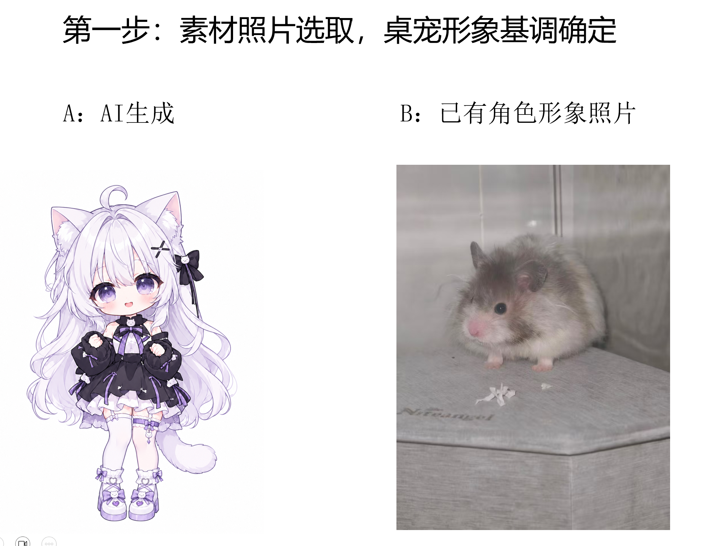
## 2、桌宠动作设计，Pavo AI视频免费生成
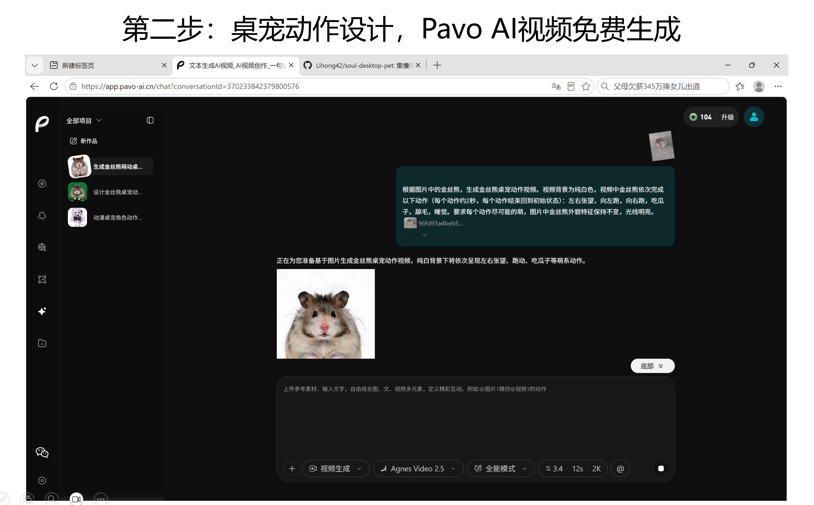
## 3、剪映视频抠图
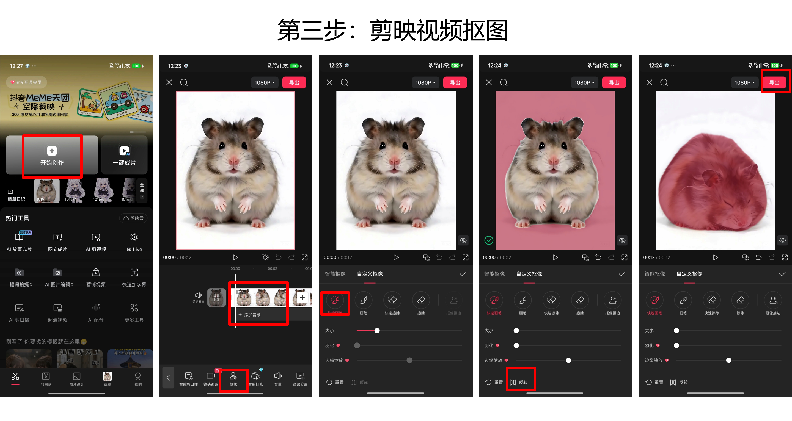
## 4、开源桌宠软件soul-desktop-pet下载，安装
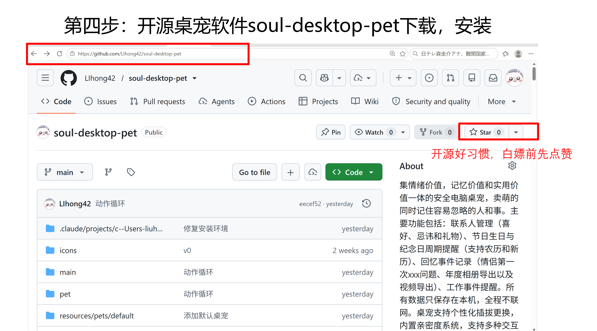
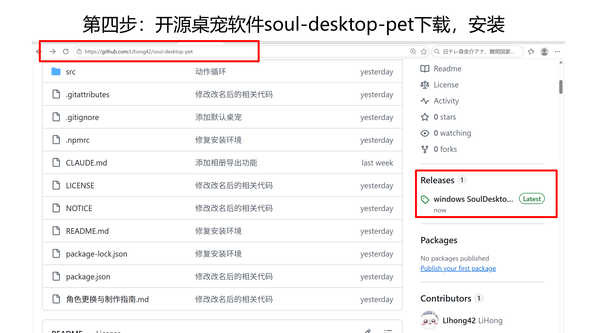
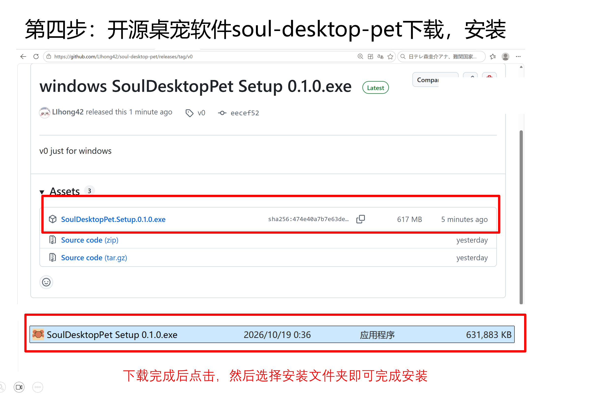
## 5、右键桌宠软件，利用工具里的分帧工具对剪映导出的视频进行分帧
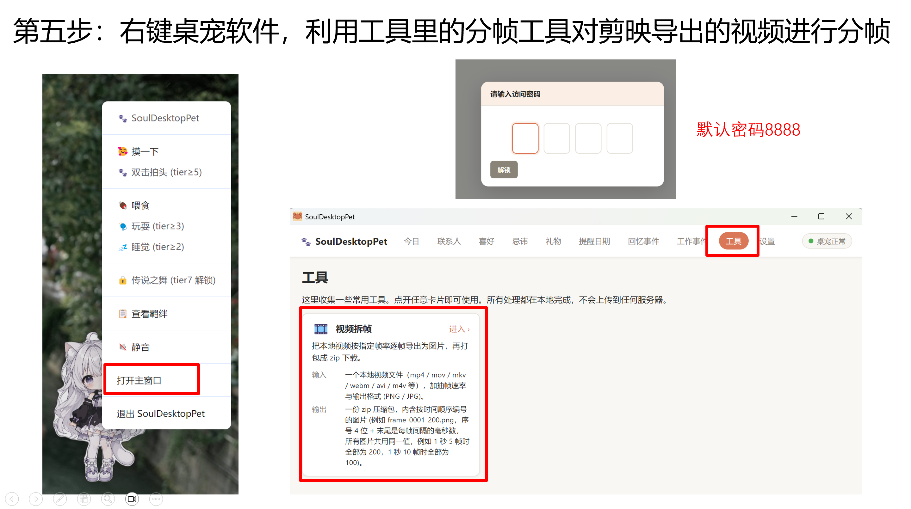
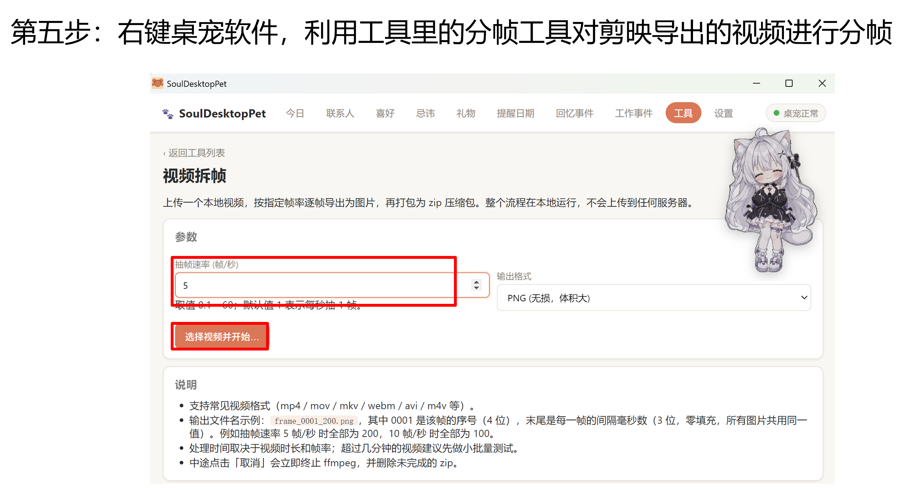
## 6、对导出的压缩包中图片按照动作进行分类，每个动作单独一个文件夹
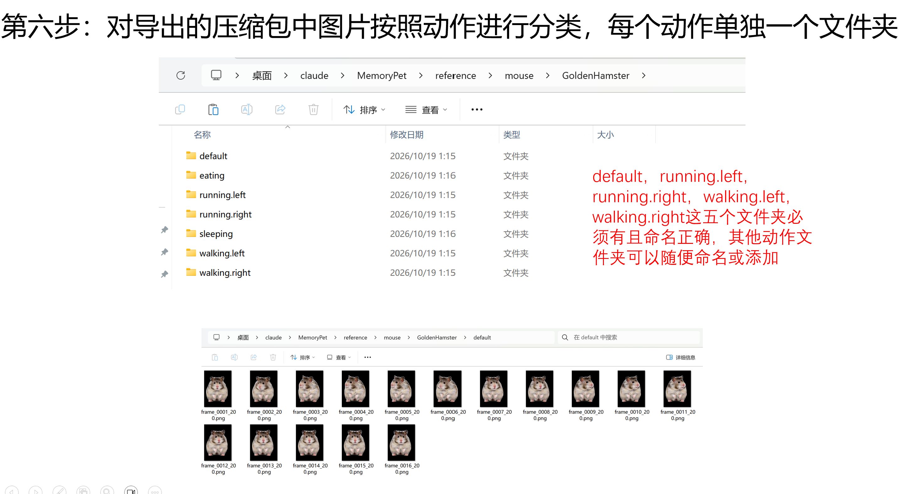
## 7、将构建好的文件夹压缩为.zip文件，并上传
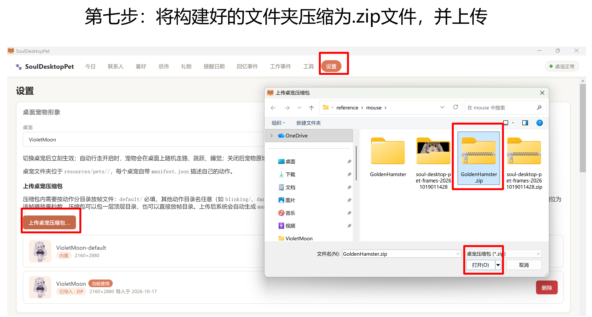
## 8、切换到上传角色，并配置角色动作循环和绑定互动动作
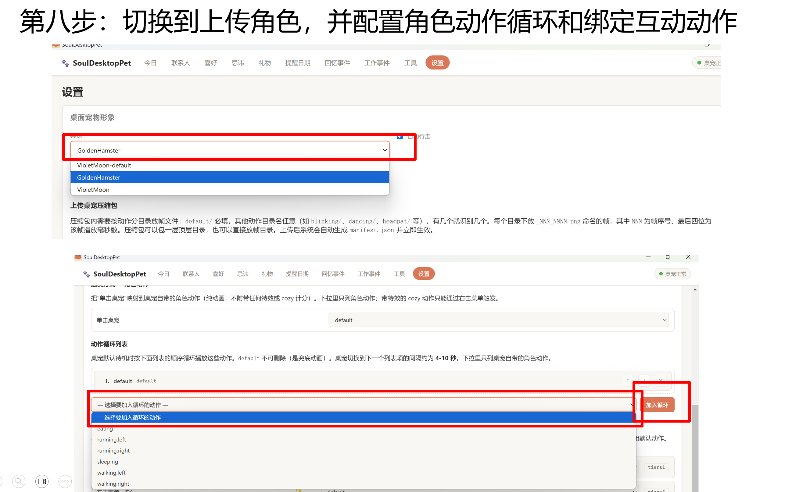
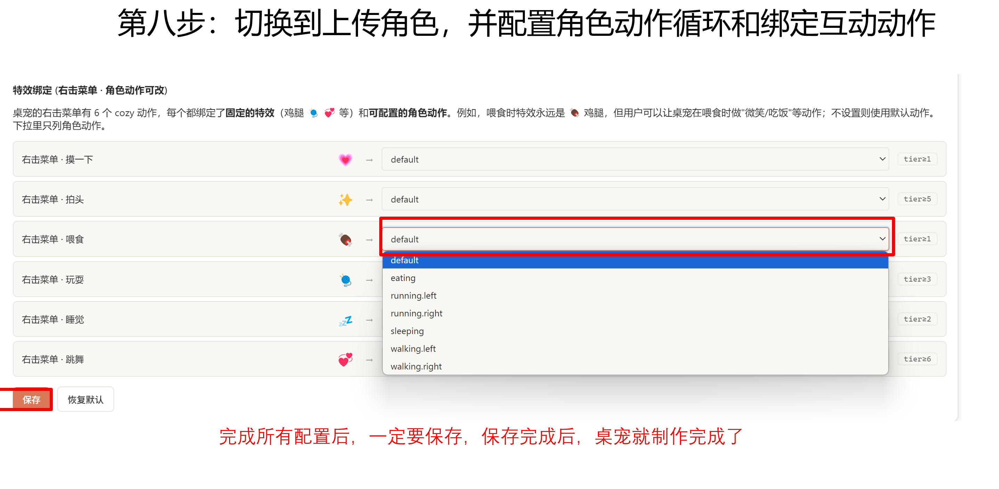